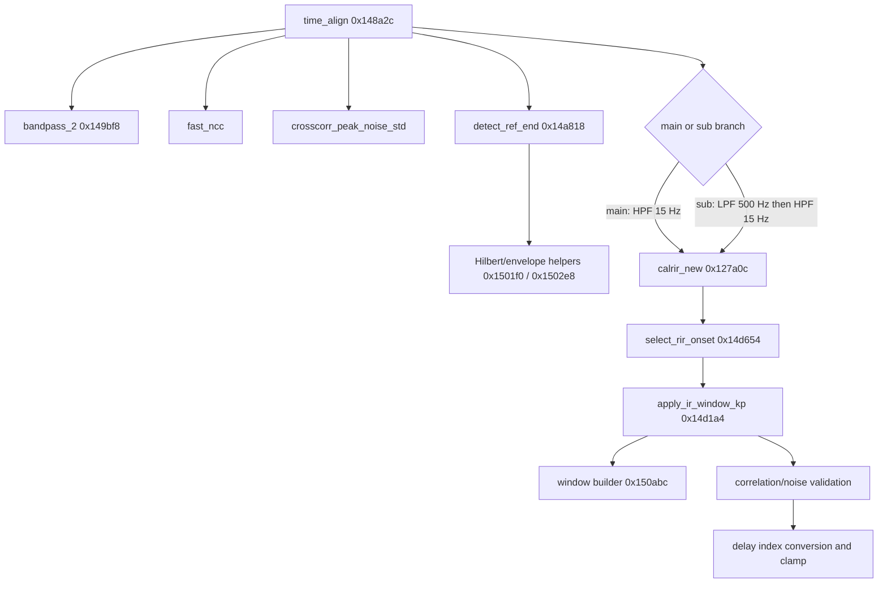
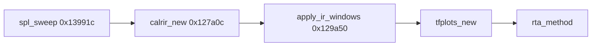

# Functions and call relationships

Artifact is ARM64 ELF `libwiimundk.so`, SHA-256 `4e3159c5ed28490e7502692071da1e6bfeb1c2c592361492464f8fd74cd510ab`, BuildID `a68007e72b0db19a91b9a6b6761fa9c20647e427`, Ghidra 12.1.4 image base `0x100000`. Addresses are provider virtual addresses.

## Alignment path

Call-graph edges reflect observed direct calls; indirect/omitted edges remain unknown as specified by REA dossier coverage. The high-level `time_align` and `spl_sweep` labels are based on address mapping previously established in the canonical Phase 1 report; all newly discussed helpers have Evidence IDs in `EVIDENCE.json`.

## Sweep response path

Phase 1 report already documents the baseline sweep/deconvolution flow and response extraction. This Phase 2 report does not relabel those earlier facts as new. Distinguish `apply_ir_window_kp` (alignment validation path; 125/12.5ms left, 800ms right) from `apply_ir_windows` (response extraction path; its previously reported 125ms/800ms/half-Tukey α=.25 parameters).

## Functions and residual unknowns

| Function / address | Phase 2 result | Confidence |
|---|---|---|
| `time_align` `0x148a2c` | ordering and mode validation summarized above | decompiler inferred; some state units unknown |
| `init_state` `0x149a48` | state slots include NCC .1, peak/noise 12, window 20ms, 256 samples, 10 and 85 block values | binary verified constants; slot semantics inferred |
| `bandpass_2` `0x149bf8` | two IIR state banks, three SOS per bank; exact cutoff semantics not recovered | partial |
| `detect_ref_end` `0x14a818` | 256-sample blocks, analytic envelope, tapered envelope energy and run state | decompiler inferred |
| `crosscorr_peak_noise_std` | exact FFT correlation peak/noise formula and caller thresholds | decompiler inferred |
| `lowpass_hz` `0x14cd24` | 500 Hz second-order low-pass at sub path | binary verified caller and frequency constant |
| `highpass_hz` `0x14cc34` | 15 Hz high-pass at main/sub callers | binary verified caller and frequency constant |
| `apply_ir_window_kp` `0x14d1a4` | mode-specific crop extents and 262144 buffer bounds | binary verified args; meaning inferred |
| `window builder` `0x150abc` | raised-cosine edge taper over 12.5% of each endpoint | binary verified formula; side/copy semantics inferred |
| `calrir_new` `0x127a0c` | baseline FFT deconvolution in Phase 1 report; exact proprietary safeguards still have residuals | see Phase 1 |
| `apply_ir_windows` `0x129a50` | response-window path in Phase 1 report | see Phase 1 |
| `spl_sweep` `0x13991c` | response extraction and parameter chain in Phase 1 report | see Phase 1 |
| `rta_method` | 65536 real FFT/log band grid and file-length predicate | partial |
| `auto_adjust_rc_freq_rta` | 695-point 20*1.01^i grid and calibration subtraction | partial |
| `calculate_autoeq_biquads` | local constrained peaking-filter optimizer and MSE model | decompiler inferred; app binding unknown |

## Key limitations

Several function dossiers are loaded from a previous REA snapshot rather than freshly re-imported; their executable digest is retained. JNI association for local AutoEQ remains unresolved. The report is not an end-to-end clone specification where decompiler pseudocode leaves semantics unknown.
